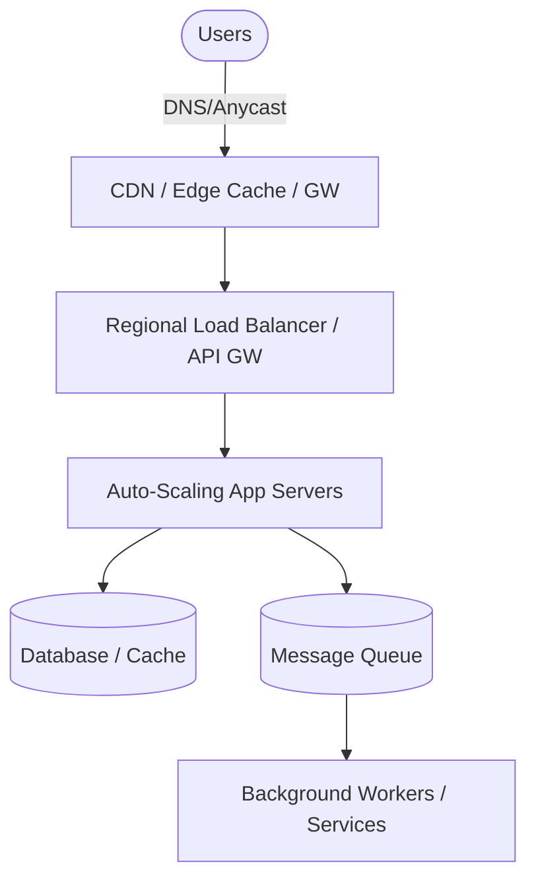

# Traffic Surge Mitigation and Scalable Architecture

**Executive Summary:** Handling sudden traffic spikes (e.g. 10,000 concurrent or burst traffic) requires a multi-faceted architecture. Key strategies include global load balancing (DNS, anycast, L4/L7), aggressive autoscaling (horizontal, warm pools, predictive), and resource protection (rate limiting, backpressure, circuit breakers). Caching (CDNs, edge) and asynchronous buffering (message queues) are essential to absorb bursts. Modern designs also integrate intelligent admission control and connection optimizations (HTTP keep-alive, HTTP/2/3). Distinguishing legitimate flash crowds from DDoS attacks informs the choice of defenses (e.g. anycast and scrubbing). AI/ML techniques (forecasting, anomaly detection, reinforcement learning) can enhance adaptability but require careful data collection, real-time constraints, and risk management. We compare approaches by cost, latency, complexity, and effectiveness, and recommend hybrid architectures (e.g. global CDN front-end + autoscaled back-end) to handle 10k+ requests/sec bursts. We also cover monitoring signals, testing strategies (load tests, chaos engineering), and open research directions in predictive scaling and anomaly detection.

## Load Balancing and Routing

Global load balancing is the first line of defense against surges. **DNS-based balancing** directs clients via name resolution, but has drawbacks: it typically routes based on the resolver IP (not the true client), can cause suboptimal placement, and suffers slow failover (due to DNS TTL caching). In contrast, **IP anycast** advertises the same IP address from multiple PoPs: routers send clients to the nearest site (fewest hops). Anycast removes DNS delay (clients always see one IP) and provides rapid failover (routing converges in milliseconds). Critically, anycast also *absorbs DDoS* by dispersing attack traffic across all locations. However, anycast must handle stickiness (session affinity) carefully since default routing picks arbitrary PoPs. A typical architecture uses multi-CDN or global anycast networks up front (e.g. Cloudflare, AWS Global Accelerator) feeding into regional layers.  

Within a region, **L4 (network layer) load balancers** quickly distribute connections (TCP/UDP) by simple metrics (round-robin, least connections, IP-hash). They have low latency/overhead but cannot inspect HTTP content. **L7 (application layer) proxies** (e.g. NGINX, HAProxy, Envoy) route on URLs, headers or cookies, enabling advanced traffic steering (A/B testing, path-based routing) at the cost of more CPU. Common algorithms (round-robin, weighted least-connections, hash-based) ensure even load. Reverse proxies and software LBs can often be scaled out themselves. For example, Cloudflare eliminated hardware LBs entirely, relying on BGP routing to spread traffic and handle failures. In practice, combining multiple levels – e.g. DNS/anycast globally, CDN edges, regional L4 LBs and local L7 proxies – yields robustness and fine-grained control.

**Key Points:** Anycast and multi-CDN front ends are excellent at minimizing client latency and sharing load (also adding DDoS resilience). DNS-based control grants precise placement but risks TTL lag. L4 is fast/simple; L7 allows smarter routing.  

## Autoscaling Strategies

**Horizontal vs Vertical Scaling:** Systems are typically designed to scale horizontally (adding servers) or vertically (bigger machines). Horizontal scaling (“scaling out”) adds more instances to distribute load, which is effective for stateless services. Vertical scaling (“scaling up”) adds CPU/RAM to a machine – this can double capacity quickly but has limits (you can’t scale infinitely) and may require downtime or reboots. Stateless microservices favor horizontal scaling because instances can be added or removed without breaking state. Vertical scaling can help for legacy or stateful components when quick hardware upgrades are possible, but it is inherently more limited.

**Reactive Scaling:** **Auto Scaling Groups (ASG)** respond to metrics (CPU, request rate). They add instances when load exceeds thresholds and remove them when idle. However, launching new VMs/containers takes time (“cold start”). To bridge that gap, *warm pools* maintain pre-initialized standby instances. AWS Warm Pools, for example, keep a configurable number of stopped or hibernated VMs ready so scale-outs are fast. This reduces scale-up latency (important for 10k/sec bursts) but incurs cost for idle capacity. Elastic (cloud) environments often support **horizontal scaling** by instantiating more stateless workers or microservice replicas as needed.

**Predictive and Scheduled Scaling:** Reactive rules can be augmented by **predictive scaling**. Predictive policies (e.g. AWS Predictive Scaling) analyze historical patterns (daily/weekly cycles) to forecast load. For example, if traffic reliably rises at 9am, an autoscaler can launch capacity a few minutes beforehand. This is especially useful when instances need warm-up (e.g. long-boot apps). Machine learning models (time-series forecasting with LSTMs, ARIMA, etc.) can improve forecasts, but require significant historical data and can mispredict if the pattern changes.  
   - **Reinforcement Learning (RL):** Recent work applies RL for autoscaling (treating scaling as sequential decisions under uncertainty). For instance, Xue *et al.* use meta-RL with a deep periodic workload predictor to scale Alibaba/Alipay workloads, achieving better performance than conventional rules. RL can learn complex scaling policies, but training is costly, policies may be opaque, and unsafe exploration can overload systems.  
   - **Warm vs Reactive tradeoff:** Reactive autoscaling is simple and cost-efficient (only grows as needed) but is slower to respond. Predictive/RL methods can preempt spikes but risk over-provisioning (wasting cost) or failing on outliers. 

**Instance Warm-Up and Pre-Provisioning:** Besides warm pools, other strategies include *container pre-warming*, pre-baked AMIs, and maintaining a minimum baseline capacity. High-performance services sometimes keep a few extra ready (“saturation slack”) to handle sudden bursts. When burst spikes (like 10k/sec) are rare, teams may over-provision enough “burst instances” just in case, balancing cost vs risk.  

**Key Points:** Horizontal scaling (adding machines) is the usual pattern for web scale (benefits from stateless design). Warm pools and predictive rules speed up scaling, but add cost. RL/autoscaling algorithms are promising for complex patterns. Vertical scaling is limited and often secondary. 

## Rate Limiting and Throttling

To protect resources from overload or abuse, **rate limiting** enforces per-client or per-user caps on requests. Common algorithms (with trade-offs noted) include:  

- **Token Bucket:** The system accumulates “tokens” over time up to a capacity. Each request consumes tokens; if none remain, requests are rejected. This allows controlled bursts (up to the bucket size) then sustains at the refill rate. Ideal for APIs that see bursts but should settle to an average rate (e.g. developer APIs).  
- **Leaky Bucket:** Conceptually a queue that drains at a fixed rate. Incoming bursts queue up but are released evenly. Good for *shaping* outgoing traffic (keeping downstream load steady). It eliminates bursts (no extra credit), which is useful when a dependent service can’t handle spikes. But it requires buffering and can add latency (waiting in queue).  
- **Sliding Window / Fixed Window:** These involve time-window counters (fix-window or sliding-window) to count requests in intervals. Fixed windows are simple but allow double-counting spikes at boundaries; sliding-window counters/logs smooth that out. They offer fine-grained fairness but at the cost of more state (timestamps, counters) and complexity.

Arcjet’s guide summarizes that *“Token bucket allows controlled bursts; leaky bucket shapes output at a steady rate; sliding window enforces recent-history fairness”*. In practice, token buckets are widely used (e.g. in network devices and APIs) because they map easily to burst allowances. Leaky buckets or concurrency throttling are often applied on the **downstream side** of a service (to protect a slower component), while token buckets can be applied at the **upstream ingress** to limit client rate.  

**Dynamic Quotas and Adaptive Throttling:** Advanced systems adjust limits in real-time. For example, an API gateway might reduce quota when backend latency spikes, or use algorithms like TCP-Vegas-inspired **adaptive concurrency limits**: measure the service’s response time and back off if latency grows. SysArt recommends exposing the internal queue depth/latency to clients as backpressure signals (see next section).  

**Costs:** Rate limiting is lightweight (often just a counter or timestamp per client), and effectively protects systems by capping overload. However, excessive limiting can frustrate users (added latency or errors) and requires careful tuning.  

**Key Points:** Token-bucket is preferred for burst-tolerant APIs; leaky-bucket or fixed output is used for shaping traffic. Sliding windows offer fairness at higher state cost. Limits should be applied on stable identifiers (user ID, API key, or IP) to prevent spoofing. 

## Backpressure and Graceful Degradation

When components start to saturate, **backpressure** and graceful degradation techniques prevent a full collapse. Backpressure means *signaling upstream or clients to slow down* before everything breaks. Unlike hard rate limits, backpressure provides a “pressure valve”: e.g. the server may advertise its queue depth in responses so smart clients can auto-throttle. Netflix’s “concurrency-limits” library uses a feedback loop similar to TCP-Vegas: it adjusts the allowed concurrent requests based on observed latency. As queues lengthen or latencies climb, the system lowers the admission rate gradually. For backend workloads (like AI inference), SysArt highlights that backpressure is often essential to avoid outright crashes (e.g. GPU OOM when overloaded).

**Graceful Degradation:** If scaling or queuing can’t fully absorb a spike, the system must “degrade gracefully.” Key patterns (from industry practice) include: 
- **Circuit Breakers:** Monitor dependent services and **trip open** when errors/timeouts exceed a threshold. After tripping, requests fail immediately (usually with a fallback or error) instead of piling up. This protects threads and connections from cascading failures. For example, Netflix’s Hystrix (2012–2018) tripped when personalization service slowed, returning generic content instead. Their API still served 99.99% availability by trading personalization for availability.  
- **Fallback Responses:** When a service fails or is slow, return a cached or simplified result rather than blocking. As Netflix showed, falling back to cached popular content kept the UI working. However, care is needed: Amazon once routed to database on cache failure, which overwhelmed the DB and caused a global outage. Fallbacks must be decoupled and tested regularly.  
- **Timeouts and Smart Retries:** Set strict timeouts on calls, and avoid retry storms (e.g. exponential backoff or limiting retry count). Without them, a single slow service can tie up threads and drive capacity to near zero.  
- **Bulkhead Isolation:** Partition resources (thread pools, connections) per dependency. If Service A goes slow, a bulkhead ensures its threads don’t exhaust Service B’s capacity. The analogy is ship compartments: one leak doesn’t sink the whole vessel. Bulkheads give “strong isolation” but at the cost of idle resources. Netflix and Azure “tempdb” scenarios use bulkheads to isolate critical services.  
- **Load Shedding / Admission Control:** When all else fails, start rejecting excess requests outright (e.g. return HTTP 503). Early rejection (load shedding) preserves core service integrity at the expense of some users. This is effectively an extreme backpressure.  
- **Partial Functionality:** Disable or simplify non-essential features under load. For example, turn off analytics, delay batch jobs, or offer a “read-only” mode. This keeps the core service operational.

These techniques ensure that **some functionality remains available under duress**, preserving user trust. They are not one-size-fits-all; combining them thoughtfully (e.g. bulkheads → circuit breaker → fallback) yields resilience. For instance, put bulkheads outermost to enforce resource limits, then breakers to stop retries. Proper observability (detailed below) is needed to detect overload and trigger these modes. 

**Key Points:** Implement backpressure signals (throttling/adaptive limits) to slow input when queues grow. Use the circuit breaker + fallback pattern to fail fast and degrade services gracefully. Bulkheads isolate failures (trade memory for resilience). Load shedding (rejecting excess) is the last resort. Thorough testing of these failures modes is essential. 

## Queueing, Buffering, and Caching

Decoupling and buffering components smooth out spikes. **Message queues (Kafka, RabbitMQ, SQS)** act as buffers: front-end services enqueue tasks or requests, which back-end workers consume at their own pace. During a flash surge, the queue absorbs the burst so front-ends can return acknowledgments (or rate-limit) without overwhelming the workers. In effect, the queue *shields* the worker from instantaneous load; new messages wait in line until capacity frees up. Modern systems rely heavily on this pattern. As RisingWave notes, message queues “store messages until consumers are ready,” decoupling producers/consumers and **buffering load spikes**. This improves reliability (persisting tasks if services crash) and smoothes throughput.

**Content Caching (CDNs & Edge Caches):** For web traffic, CDNs offload repeated or static content to the edge. A well-configured CDN can absorb a huge fraction of requests at PoPs near users, drastically reducing origin load. Caching can be at various layers: CDNs for static assets, reverse-proxy caches (Varnish), and even in-memory caches (Redis) for database results. By serving content directly, caches turn potential request “storms” into cheap hits. Caches must be “invalidation-aware” if content is dynamic, but even caching HTML fragments or API responses (with short TTL) buys substantial headroom. Netflix, for example, used CDN caching so effectively that many spikes never hit their origin. 

 *Figure: Message queues decouple producers from consumers, buffering requests during traffic surges. (Source: RisingWave)*  

**Database/Storage Buffers:** Sometimes, writes are buffered too (e.g. write-ahead logs, write-behind caches) so that backend systems can queue IO. For example, using Apache Kafka as a write log and consumers update the database lazily. This spreads out DB load. Similarly, using Rate-limiting proxies or traffic policers (e.g. nginx delay-mod, Envoy local rate limit) provides short-term headroom. 

In short, queueing and caching act as **shock absorbers** for surges. They trade added latency (a message waits in queue) for stability. Their cost is complexity and memory/disk resources, but they are vital for burst resilience. 

## Resilience Patterns: Circuit Breakers and Bulkheads

As discussed, **circuit breakers and bulkheads** are specialized fault-isolation patterns crucial in high-concurrency systems. A *circuit breaker* watches service success rates: when failures exceed a threshold, it “opens” the circuit so that further calls fail immediately with a fallback. This prevents one slow/faulty dependency from stalling all threads. Importantly, it periodically allows test calls (“half-open”) to detect recovery. Hystrix popularized this idea, and it has since been integrated into frameworks (Resilience4J, Envoy). If poorly configured, breakers can either trip too late (ineffective) or too early (unnecessary denial of service). 

A *bulkhead* partitions resources (threads, connection pools) so that if one dependency is slow, it cannot hog everything. For example, a service might have one thread pool for calls to Payment API and a separate pool for a Recommendations API. If payments stall, recommendation threads still run. Bulkheads “exchange efficiency for resilience”: each partition must be sized for peak load. Bulkheads are especially recommended for external or critical dependencies.  

 *Illustration: In resilience pattern trade-offs, bulkheads isolate faults strongly (at high resource cost), while load shedding protects overall capacity by rejecting work early.*  

In practice, these patterns accompany autoscaling and rate-limiting. For instance, a server might cap concurrent requests per user (bulkhead) and enable circuit breakers on each outbound call. Coupling these with health checks and service mesh observability (e.g. outlier detection) ensures that a single failing service doesn’t cascade into system-wide failure. 

## Connection Management (Keep-Alive, HTTP/2, QUIC)

Efficient use of connections is critical under bursty load. **Keep-Alive (persistent connections)** avoids the overhead of TCP handshake on each request, so clients reuse open sockets for multiple HTTP requests. This reduces latency and server load during spikes. HTTP/2 and HTTP/3 further optimize connection usage: they multiplex many streams over one connection.  

- **HTTP/2:** Multiple requests/responses share a single TCP connection, which reduces handshake overhead and improves utilization. However, TCP still has head-of-line blocking: if one packet is lost, all streams on that connection wait.  
- **QUIC/HTTP/3:** QUIC replaces TCP for HTTP. It runs over UDP with built-in TLS, 0-RTT handshake, and fully independent streams. As Cloudflare notes, QUIC *“eliminates the head-of-line blocking that plagues HTTP/2,”* so a loss on one stream doesn’t stall others. QUIC’s faster handshake (combining crypto and transport setup) also reduces connection latency. In high-concurrency scenarios, QUIC can deliver better performance at the cost of requiring client support and newer infrastructure. In short, enabling keep-alive and HTTP/2 is a low-hanging fruit, while HTTP/3/QUIC can yield additional gains in a congested or loss-prone network.

In practice, ensure server thread pools and file descriptors are tuned for many concurrent sockets (e.g. Linux `net.core.somaxconn`) and use a load balancer or proxy that supports HTTP/2/3. Reject stale TLS sessions when needed (`ssl_session_tickets` reuse) to avoid memory bloat. 

## DDoS Attacks vs. Legitimate Flash Crowds

Sudden traffic spikes may be **legitimate** (e.g. viral news) or **malicious DDoS**. The remedies overlap but have differences. From the victim’s view, a flash crowd and a volumetric attack both look like huge inbound traffic. However, DDoS often lacks session completion or comes from suspicious sources. Key distinctions: DDoS is usually higher-volume, shorter-lived, and may target low-level resources (UDP flood, SYN flood) or application endpoints in a scripted way. Flash crowds are genuine users and can often be managed by scaling or caching.

Mitigation tactics:  
- **Anycast/CDN:** Both DDoS and flash crowds benefit from anycast/CDN distribution, which shares load globally. Indeed, *“anycast routing naturally absorbs distributed DDoS attacks”* by dumping excess traffic across many PoPs. Large CDN networks (Cloudflare, Akamai) often stop large volumetric attacks simply by dispersal. Flash crowds also benefit as CDNs serve the bulk of content.  
- **Scrubbing services and firewalls:** For DDoS, specialized scrubbing networks (Akamai Prolexic, AWS Shield, Cloudflare WAF) can detect anomalous signatures or high-packet attacks and filter them out, at high cost. Flash crowds typically bypass such scrubbing.  
- **Rate limiting and CAPTCHA:** If usage patterns look non-human (same IP bursts), one might throttle or add challenges. But be cautious: legitimate bots (Google crawler) could also be throttled.  
- **Monitoring anomalies:** Anomaly detection ML models (see below) can flag unusual traffic distributions. For instance, if new IP clusters appear too suddenly, or the failure rates spike (bots often hit endpoints without completing flows).  

In essence, treat the spike as legitimate until proven otherwise. Autoscaling, caching, and admission control protect against both. If an attack is confirmed, engage DDoS defenses (e.g. drop all but essential endpoints, engage WAF rules). Documented case: Cloudflare repelled a record **7.3 Tbps** DDoS in May 2025 by quickly distributing and scrubbing traffic. Flash crowd events (like Reddit linking) are best handled by autoscale + CDN. 

## Cost and Latency Trade-offs

Every mitigation has a cost-performance trade-off. Over-provisioning capacity (idle servers, warm pools) increases cost but minimizes latency under surge. Conversely, strict rate limits or heavy caching reduce server load (cost) but can increase latency for some users (e.g. cache-miss or delay). Some patterns (bulkheads) use more CPU/memory to isolate, trading hardware for higher availability. Others (load shedding) preserve resources by dropping requests, which saves cost at the expense of user-facing errors. 

In cloud environments, providers often charge by CPU/hour or instance-second, so a policy that scales before need (predictive/RL) might spin up extra nodes, increasing bill, whereas reactive policies keep costs tighter but risk slower response. Likewise, using a CDN costs additional bandwidth fees, but offloads origin servers (reducing compute costs and latency). 

We compare techniques later in a table. In summary, the ideal balance depends on your SLA: a 99.999% uptime requirement might justify paying for overcapacity and advanced networks, whereas a lower tier might accept a few dropped users and simpler rules to save cost.

## AI/ML Approaches

**Traffic Prediction:** Machine learning can forecast traffic patterns to pre-scale resources. Time-series models (ARIMA, LSTMs, Transformers) learn from historical logs. For example, Alibaba/Alipay used a learned workload predictor (deep periodic model) combined with RL to auto-scale predictively. AWS Predictive Scaling (built on ML) uses simple pattern detection (daily/weekly cycles). Data needs: reliable historical metrics (requests/sec, CPU usage) and context (time-of-day, special events). ML models must run fast enough – typically batch predictions a few minutes in advance, not per-request. If model inference is too slow, it can’t help real-time bursts. 

**Anomaly Detection:** To catch sudden malicious traffic or unusual patterns, supervised or unsupervised ML can help. For instance, classification models (Random Forest, SVM) have been trained to distinguish flash crowds from DDoS by features like entropy of source IPs, request timing, or protocol use. Unsupervised methods (autoencoders, clustering) flag deviations from normal baselines. However, ML anomaly detection is tricky in practice: false positives may throttle valid users, and attackers may evade simple signatures. Good data (labelled attacks) is required for supervised learning. 

**Reinforcement Learning for Scaling:** As mentioned, RL can automate autoscaling decisions by learning from rewards (e.g. low latency + low cost). Meta-RL and transfer learning have been researched to adapt policies across apps. Integrating RL requires a simulator or safe exploration mechanism (bad decisions can break SLAs). Many ML-driven autoscaling systems use RL in lab, then translate policies to simpler rules for production. 

**ML Models (e.g. MLPs):** Even simple neural networks (MLPs) or regression models are used to estimate future load based on features (hour of day, marketing events, etc.). Feature engineering (e.g. correlation with calendar events) can improve forecasts. 

**Integration and Risks:** ML components must operate under latency constraints: predictions and detections often need to be near-real-time (seconds) for autoscaling triggers. Online learning or adaptive re-training may be needed as traffic evolves. Risks include concept drift (model becomes outdated), adversarial traffic, and increased system complexity. As a rule, ML should augment but not fully replace deterministic controls. Always implement fallbacks (e.g. if model fails, revert to reactive scaling or safe limits). 

**Key Points:** AI can enhance scaling and defense (pattern recognition, forecasting), but requires careful data pipelines and monitoring. Latency of ML decisions must match system needs. Always validate ML models and plan for failure modes. 

## Comparative Analysis of Techniques

The table below summarizes trade-offs of various techniques against metrics like cost, latency impact, complexity, and effectiveness in handling surges. These are general trends and may vary by context:

| **Technique**                  | **Cost**   | **Latency**      | **Complexity**    | **Effectiveness**                |
|-------------------------------|:----------:|:----------------:|:-----------------:|:--------------------------------:|
| **Global DNS LB**             | Low        | Medium (TTL)     | Low               | Medium (depends on DNS caching)  |
| **Anycast / Global LB**       | High       | Low (fast route) | High (network infra) | High (fast failover, DDoS resilience) |
| **L4 Load Balancer (e.g. ELB)**| Medium    | Low              | Medium            | High for TCP load distribution   |
| **L7 Reverse Proxy (e.g. NGINX)**| Medium  | Low-Med          | Medium            | High (smart routing, SSL offload)|
| **Horizontal Scaling**        | High       | Low (scale out)  | Medium-High       | High (adds capacity)             |
| **Vertical Scaling**          | Medium     | Medium           | Low-Med          | Medium (limited by hardware)     |
| **Warm Pools / Pre-warm**     | High       | Very Low         | Medium            | High (fast scale-out)|
| **Predictive Scaling (ML)**   | High       | Low (pre-scale)  | High (models)     | High (if patterns exist) |
| **Token Bucket Limiting**     | Low        | Low (rejections) | Medium            | Medium-High (allows bursts)|
| **Leaky Bucket / Throttling** | Low        | Medium (steady)  | Medium            | Medium (shapes traffic)|
| **Sliding Window Limiting**   | Medium     | Low              | High (state)      | High (accurate fairness)         |
| **Message Queue Buffering**   | Low-Med    | High (delay)     | Medium            | High (smooths spikes)|
| **CDN Caching**               | Medium     | Very Low         | Medium            | High (offloads origin)           |
| **Circuit Breaker / Bulkhead**| Low        | Low              | Medium            | High (isolates failures)|
| **Load Shedding (Reject)**    | Low        | N/A (fails)      | Low               | Medium (protects core)           |

*Notes:* Cost reflects infrastructure and operational cost. Latency is impact on request latency. Complexity is engineering effort. Effectiveness is approximate surge-handling benefit. (E.g. anycast has high setup cost but very effective for resilience.) 

## Recommended Architecture for 10k/s Bursts

To handle ~10,000 requests/sec bursts, we recommend a **multi-layered, distributed architecture**:  

- **Edge Layer (Anycast/CDN):** Use a global CDN or anycast network to serve static content and absorb regional surges. For dynamic content, terminate SSL and route through an anycast IP (e.g. CloudFront/Global Accelerator) so traffic enters the nearest PoP. This reduces round-trip latency and spreads load globally.  
- **Ingress Gateways:** Behind the edge, deploy geographically-distributed API gateway/proxy clusters (e.g. AWS ALB + NGINX or Envoy mesh). These handle TLS offload, HTTP/2, and initial rate-limiting. They also enforce IP-based or geo-blocking rules during suspected attacks.  
- **Autoscaling Compute Tier:** The gateway forwards to an auto-scaling group of application servers (horizontal scaling). Use warm pools or keep a buffer of idle instances for fast scale-out. Ensure instances are stateless or use sticky session with a cookie if necessary.  
- **Queue/Service Bus (if applicable):** For any back-end tasks (e.g. heavy processing, DB writes), use a message queue. The app servers enqueue jobs to Kafka/SQS, and workers process asynchronously. This decouples front-end bursts from slow back-end work.  
- **Back-end Services / Databases:** Auto-scale read replicas of databases, use caching layers (Redis). If using shards or partitioning, ensure they can also be scaled (e.g. CosmosDB autoscale). Bulkheads isolate critical DB connections.  
- **Auxiliary Layers:** Use a circuit-breaker library or service mesh (Istio/Linkerd) to wrap outbound calls. Implement health checks and graceful shutdown (to drain connections on scale-in).  

Below is a conceptual flowchart of request handling in such a design:

*Figure: Hybrid architecture with global CDN/anycast front-end, autoscaled services, and buffering. (Edge CDN distributes content; LB routes to app servers; queues decouple back-end processing.)*  

This multi-region, stateless design with ample caching and queueing can handle sudden spikes by localizing traffic and growing back-end capacity. The **mermaid chart** above illustrates how user requests enter via DNS/anycast/CDN, flow through load balancers, and are processed by an autoscaling pool, with queues and caches smoothing the load.

## Implementation Steps and Best Practices

1. **Capacity Planning:** Estimate normal vs peak loads. Provision initial fleet and choose instance types. Decide on vertical vs horizontal mix.  
2. **Configure Global DNS/Anycast:** Deploy a multi-CDN strategy or at least one global DNS provider with health checks. If using anycast (Cloudflare, AWS Global Accelerator), advertise IPs globally.  
3. **Set Up Load Balancing:** Use L4/L7 balancers with health checks. Tune connection timeouts and max connections. For L7, enable keep-alive and HTTP/2.  
4. **Implement Autoscaling Policies:** Define simple reactive policies (e.g. scale out at 70% CPU, in at 30%). Add scheduled/pre-warm if patterns exist (e.g. scale up at business start). Consider enabling warm pools for long-boot servers.  
5. **Add Rate-Limits and Backpressure:** On ingress or GW, apply token-bucket limits per client/API key. Instrument queue depths and latencies to expose backpressure signals. Optionally, implement adaptive concurrency (Netflix’s library) to automatically throttle.  
6. **Circuit Breakers and Bulkheads:** In code or mesh, wrap external calls with breakers (trip on ~50% failures). Use separate thread pools or semaphores for critical calls (bulkheads).  
7. **Graceful Degradation:** Prepare fallback content and feature flags. For example, if personalization fails, return generic data. Test fallbacks with chaos tests.  
8. **Monitoring:** Instrument metrics for request rates, error rates, latencies, CPU/mem, queue lengths. Track per-service health and global traffic patterns. Use alerting on anomalies (e.g. 5xx spike).  
9. **Chaos Testing:** Periodically simulate surges or failures (e.g. using tools like Chaos Monkey, Gremlin). Verify that autoscaling and circuit breakers work as intended and that performance remains acceptable.

## Monitoring and Observability

Key signals include:  
- **Traffic Metrics:** requests/sec, connection rate (from load balancer logs). Spikes here should correlate with scaling events.  
- **Resource Utilization:** CPU, memory, network on instances. Use high-res metrics (1s-interval) to catch sharp spikes.  
- **Queue Depths and Latencies:** Monitor message queue lengths and service response latencies to detect backpressure. Sudden climbs in queue backlog or tail latency warn of overload.  
- **Error Rates:** 5xx errors or circuit-breaker rejections. A sudden jump may mean a downstream failure is causing retry storms.  
- **Autoscale Events:** Log scale-out/in actions. Ensure scaling happens early enough.  
- **Security / Traffic Anomalies:** Metrics on distribution of source IPs (entropy), request patterns per IP, etc., to detect DDoS.  

Centralized logging and tracing (e.g. ELK/Prometheus/Jaeger) help diagnose problems during spikes. Instrument fallback paths explicitly (e.g. metrics on when fallbacks are used).

## Testing and Chaos Engineering

- **Load Testing:** Simulate burst loads (e.g. using Locust, k6) well above expected peaks to validate scaling behavior and rate limits. Test both legitimate bursts and illegitimate traffic (simulate bot traffic).  
- **Chaos Scenarios:** Intentionally disable instances or services to ensure fallback modes engage. For example, kill a subset of instances during high load to see if others pick up or if degradation happens gracefully. Netflix-style failure tests (latency injection, service kill) build confidence.  
- **DDoS Drills:** Conduct practice attack scenarios (in coordination with networking team or using security testing) to tune DDoS defenses and ensure alerts fire.  
- **Monitor SLA:** Throughout tests, measure success (throughput, latency, error rate) to validate SLAs. Tune thresholds and policies based on results.

## Open Research Directions

While many techniques exist, key research areas include: 
- **Advanced ML for Forecasting:** Better models that account for unprecedented events (e.g. viral trends) or multi-variate factors (social media buzz). Hybrid models combining causal signals (calendar, marketing) with deep learning are promising.  
- **Online Adaptive Control:** RL is powerful but risky; exploring safe RL (incorporating domain constraints) or meta-learning (transfer policies across apps) could make it more practical.  
- **Real-time Anomaly Detection:** Fast, low-latency ML methods (perhaps using streaming analytics) to detect complex DDoS patterns. Graph-based detection of botnets, and adversarial ML resilience, are active areas.  
- **Fine-grained Autoscaling Metrics:** Beyond CPU/request rate, metrics like queue latency, error rates, or business metrics (e.g. transactions/sec) in autoscale loops. Learning which metrics best predict load.  
- **Serverless/Edge Scaling:** With FaaS and edge compute (Cloudflare Workers, Lambda@Edge), scaling is more granular. Research on how burst management changes in these paradigms (cold starts, concurrency limits) is evolving.  
- **Cost-Aware Scaling:** Multi-objective scaling that balances cost vs latency automatically, possibly using optimization or learning. Cloud pricing dynamics (spot instances, reserved vs on-demand) can be integrated into scaling decisions.  

Continued innovation will likely come from combining these techniques in self-driving systems: e.g., systems that *autonomously* predict and shift traffic, reconfigure CDNs, and tune rate-limits with minimal human intervention. 

**Sources:** Research papers, cloud documentation, and industry case studies as cited above. 

